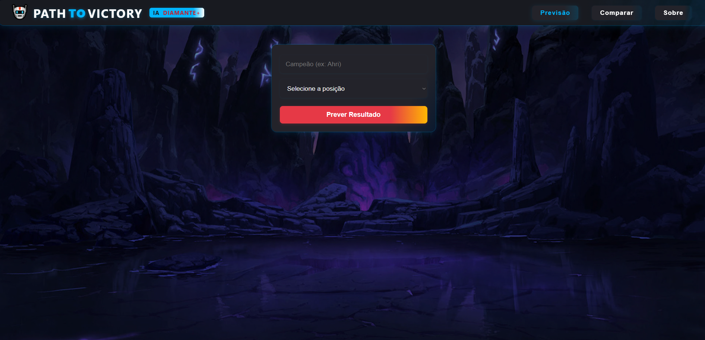
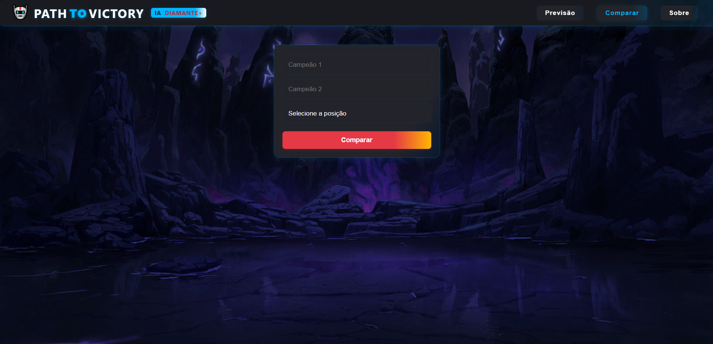
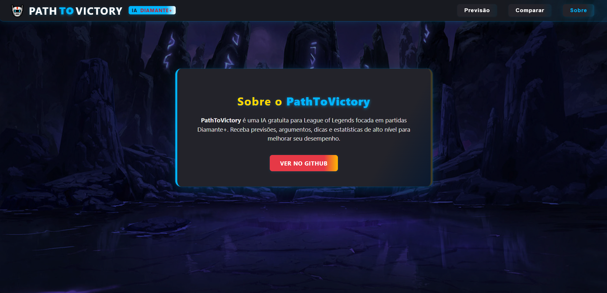

# 🤖 PathToVictory

**PathToVictory** is a free AI tool for League of Legends focused on Diamond+ matches. It delivers win predictions, reasoning, tips and high-level statistics to help players improve in solo queue.

## ✨ What is PathToVictory?

- **Win prediction:** give your champion, rank and position and see the win probability, win rate, average KDA, builds, strengths and weaknesses, plus automatically generated arguments.
- **Champion comparison:** compare two champions in the same lane and find out, with real high-elo data, which one is better in the current meta.
- **Real statistics:** data extracted from real Diamond+ matches, processed by AI and refreshed through an automated pipeline.
- **Modern front-end:** responsive React interface with dark mode and animations.
- **Solid back-end:** Flask + Node APIs that serve predictions and data, easy to run locally.

## 🚀 Getting started

### 1. Clone the repository

```bash
git clone https://github.com/Alan-VSouza/Path-To-Victory.git
cd Path-To-Victory
```

### 2. Python back-end (Flask)

**a) Install the dependencies**

```bash
cd backend/python
pip install -r requirements.txt
```

**b) Generate the data and train the model**

Edit `champion_pipeline.py` to choose the champions and sample sizes you want, then generate `champion_stats.csv` and `winrates.json`:

```bash
python champion_pipeline.py
```

Train the model (if needed):

```bash
python train_model.py
```

**c) Start the Flask API**

```bash
python predict_api_dynamic.py
```

The API is available at `http://localhost:5001/api/predict` and `/api/compare`.

### 3. Node back-end (optional, serves match_data.json)

```bash
cd ../node
npm install
npm start
```

Open `http://localhost:5000/api/match_results`.

### 4. React front-end

```bash
cd ../../frontend/path-to-victory-react
npm install
npm start
```

Open `http://localhost:3000`.

## 🧠 How it works

- **Data pipeline:** Python collects Diamond+ matches through the Riot API, computes win rate, KDA, builds, suggested bans and strengths/weaknesses (automatically translated), and saves everything ready for the back-end.
- **Machine learning:** a RandomForest model trained on champion, position, rank and KDA features predicts wins and losses.
- **Flask back-end:** serves predictions, arguments and champion comparisons through a REST API.
- **React front-end:** modern, responsive UI with forms, result cards, animations and dark mode.
- **Comparison:** smart messages highlight the champion with the advantage based on real data.

## 🎯 Goals

- Make high-level statistics and predictions available to every LoL player.
- Explain, clearly and with arguments, the reason behind each recommendation.
- Encourage better solo queue decisions based on real data, not guesses.
- Be easy to run locally and serve as a base for studying applied AI in games.

## 🛠️ Tech stack

- **Python** (pandas, scikit-learn, Flask, googletrans)
- **Node.js** (Express)
- **React** (Hooks, modern CSS)
- **Riot API** and **Data Dragon**

## 📸 Screenshots

<p align="center">
  
</p>
<p align="center">
  
</p>
<p align="center">
  
</p>

## 📚 Credits

- Data: Riot Games API, Data Dragon
- Inspiration: LoLalytics, Mobalytics, u.gg

## 📝 License

MIT

> **PathToVictory**: AI and data for players who want to genuinely improve at LoL.
> Feel free to contribute, suggest improvements or use it as a base for your own project.
